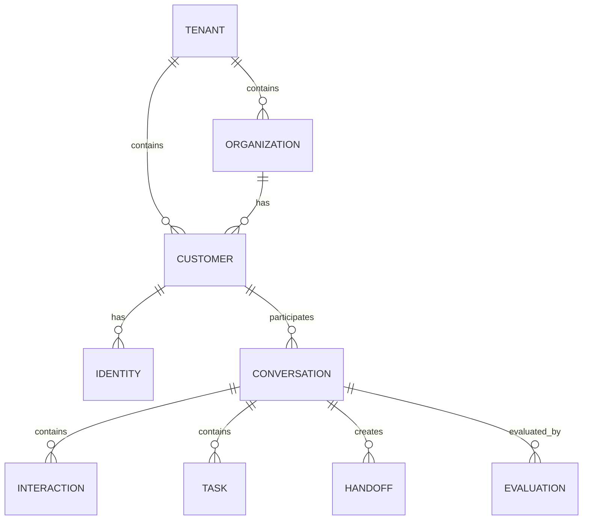

# Domain Model

Baseline: 0.0，2026-09-07；D1–D6 批准依据见 [ADR-0010](../adr/0010-approved-domain-baseline.md)。

## 1. 核心实体



## 2. Entity Summary

### Tenant

租户边界。所有身份唯一性、Policy、Routing、Data access 都以 tenant 隔离。

### Organization

ToB 场景的一等公民。

示例：

```yaml
organization:
  id: org_acme
  name: Acme Inc.
  plan: enterprise
  region: singapore
```

### Customer

具体联系人 / 服务对象。

### Identity

连接跨渠道身份：

```yaml
identities:
  - type: phone
    value: "+6591234567"
  - type: email
    value: "jack@acme.com"
  - type: external_id
    provider: crm
    value: "crm_8891"
```

### Conversation

一个持续的客户服务上下文。

Conversation 可以包含来自不同渠道的 Interaction。

### Interaction

统一表示：

- customer message
- AI message
- human message
- voice transcript
- tool call
- tool result
- system event
- handoff event

### Task

用于表达需要推进的业务步骤，而不是让 Agent 无限自由聊天。

### Handoff

AI / Human / Specialist Agent 之间的结构化责任转移。

### Evaluation

对 Conversation / turn / action 的质量评价。

## 3. Invariants

- Identity 在 Tenant 内唯一。
- Core Domain 不出现 `chatwoot_*` / `livekit_*` 业务字段。
- Provider ID 可以存入 metadata / external references。
- Conversation 不等于 channel session。
- Customer 不等于 phone number / contact record。
- Handoff 必须有 lifecycle。
- 关键副作用必须有 Interaction / audit trace。

## 4. V0.1 会话与身份边界（D1）

集成绑定先确定可信 tenant。用 `(tenant_id, provider, external conversation id)` 查显式 external reference；存在则返回既有 Core Conversation，不存在则在租户内建立映射。
映射写入必须原子化并具备唯一约束，并发首次事件不能创建两个有效映射。provider account/inbox 属集成配置作用域，Adapter 必须使 external id 在此作用域内无歧义，例如组合 account id 与 conversation id。

Contact 同样经租户内显式映射找到 Customer。名称、电话、邮箱相似不能触发自动合并；同一外部联系人在不同 tenant 的身份和会话互相独立。
Organization 可为空；不得因缺少组织而跨租户搜索或猜测归属。引用实体、会话、客户及组织都必须在同一 tenant。

已映射的 provider 会话关闭/重开沿用 Core id，不清空 Interaction 历史。
业务 resolution 单独记录，不能把 provider 的关闭状态当作已经解决客户问题。`pending_human` 不等于 resolved。
未确认身份、无映射来源的事件不能进入需要 customer_id 的当前信封；暂存/解析属于 ingestion 实现，不用虚构客户补值。

## 5. 行为验收

| 输入 | 必须成立 |
|---|---|
| 同租户同 provider 外部会话重复到达 | 同一个 Core Conversation |
| 原会话关闭后重开 | Core id 与历史不变；解决状态由独立事件维护 |
| 不同 tenant 使用相同 external id | 相互隔离，拒绝跨租户关联 |
| 两渠道显示相同 email/name | 不自动合并 Customer 或 Conversation |
| 两个入站事务同时首次建映射 | 唯一映射，无重复有效会话 |
| Handoff 请求后继续有客户消息 | 可保存 Interaction；不得绕过 AI 输出暂停 |

上表是后续 TASK-102/103 的验收契约；Foundation 不包含持久化运行实现。
