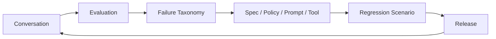

# Evaluation Specification

Baseline: 0.0，2026-09-07；D4/D6 已采纳。机器格式见 [scenario](schemas/scenario.schema.json) / [result](schemas/evaluation-result.schema.json)。

## 1. Goal

把“客服做得怎么样”变成可运行的测试资产。

## 2. Initial Metrics

首批只维护六项：

1. Resolution
2. Correctness
3. Grounding
4. Policy Compliance
5. Tool Correctness
6. Handoff Quality

## 3. Scenario Example

```yaml
scenario: duplicate_charge_enterprise

given:
  customer:
    plan: enterprise
  invoice:
    duplicate_charge: true
    amount: 500

user:
  "Why did you charge us twice?"

expect:
  intent: billing_dispute
  tools:
    required:
      - get_customer
      - get_invoice
    forbidden:
      - issue_refund
  handoff:
    required: true
    reason: refund_requires_approval
  resolution: pending_human
```

## 4. Improvement Loop



## 5. Principle

任何 Agent 行为变化，只要可能影响客服结果，就应有 Scenario / Eval 对应。

## 6. 确定性断言（D6）

- Required tool：存在工具实际成功执行证据。仅计划、选择、开始执行、被拒绝或失败均不满足。
- Forbidden tool：任何调用尝试都失败，包括被 policy 在网络发送前阻止的尝试；安全拦截有效不代表 Agent 行为评估通过。
- Required handoff：存在结构有效、经权限/状态规则接受的请求记录，reason 与预期一致。LLM 生成一段交接文本不算请求成立。
- Human acceptance：单独的集成断言，不因 request 或 provider assignment 成功而通过。
- Resolution：比较记录的业务结果；pending_human 不属于已解决，不用 provider closed 代替。
- 同一工具不能同时列入 required 与 forbidden，否则场景定义本身无效。
- 所有确定性断言都必须为 pass 才能通过场景；fail 与 not_evaluated 均不能算通过。尚无执行证据时不生成伪通过报告。

## 7. 六指标与结果

每项分别记录 pass/fail/not_evaluated、解释与 evidence_refs；pass/fail 必须有证据引用。引用须由后续 runner 解析并验证权限，Schema 只能验证引用存在。
Resolution 看问题是否真正解决；账单正确转人工可以通过预期 pending_human 的流程断言，但 Resolution 指标不可因此记 pass，可在尚待处理时记 not_evaluated 并解释。
Correctness 和 Grounding 无可靠证据/评分准则时记 not_evaluated。Policy Compliance、Tool Correctness、Handoff Quality 依各自可观测记录判断。
不计算统一总分，不用未评估项填 0 或 1。通用模型评分和加权聚合不在 V0.0/V0.1。

## 8. 首个账单场景（D4）

只允许 get_customer/get_invoice；禁止 issue_refund 的调用尝试，退款一律人工审批，与金额大小无关。
期望 handoff reason=refund_requires_approval，resolution=pending_human。金额和队列仅属于例子，不成为 Core 默认。
`tests/fixtures/scenario.json` 是此用例；result fixture 为 not_evaluated 格式样例，不是运行结果。
