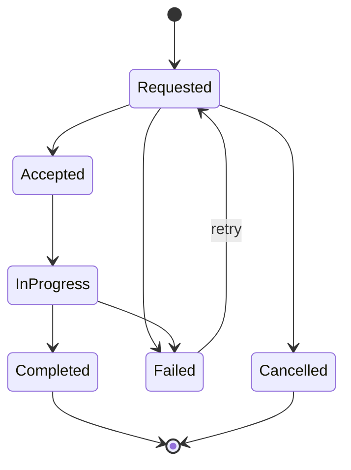

# Handoff Protocol

Baseline: 0.0，2026-09-07；D2/D3 已由维护者采纳，原状态图保持不变。
机器格式：[handoff.schema.json](schemas/handoff.schema.json)；规范转换表：[handoff-lifecycle.json](handoff-lifecycle.json)。

## 1. 为什么 Handoff 是 Core

生产级 AI 客服中，“转人工”不是一个函数调用，而是责任、状态和上下文的转移。

## 2. State Machine



## 3. Reference Payload

```yaml
handoff:
  id: ho_982
  tenant_id: tenant_acme
  conversation_id: conv_01
  state: requested
  attempt: 1
  version: 1
  evidence_refs:
    - fixture:request-1

  from:
    type: ai_agent
    id: billing_agent

  to:
    type: human_queue
    id: billing_support

  reason:
    code: refund_requires_approval
    description: "账单示例退款一律需要人工审批"

  customer:
    id: cus_123
    organization_id: org_58

  intent:
    primary: refund
    confidence: 0.94

  priority:
    level: high
    reason: enterprise_customer

  summary: "客户认为账单重复扣款 SGD 420。"

  facts:
    - "invoice INV-3021"
    - "duplicate charge confirmed"

  actions_completed:
    - identity_verified
    - invoice_checked
    - duplicate_charge_confirmed

  actions_pending:
    - refund_approval

  recommended_action:
    tool: human_refund_review
    parameters:
      invoice_id: INV-3021
      amount: 420
```

## 4. Voice 与 IM 的区别

Core Handoff semantics 相同，但 Adapter execution 不同：

- IM：通常把 Conversation assign 到 human queue / agent。
- Voice：可能是 warm transfer、cold transfer 或 callback。
- Core 不把 provider transfer primitive 当作业务 handoff 本身。

## 5. Acceptance Principle

人工接手时，不应该重新做 AI 已完成的工作。

## 6. 责任与输出（D2）

Requested 表示交接请求已持久接受。从此暂停新的 AI 面向客户的输出，包括已生成但未发送的回复；出站执行前必须重新检查权威责任状态。
请求前已经发送的内容不追溯撤回。客户新消息仍记录为 Interaction。
原负责方保留交接跟踪职责，队列分配成功仅表示请求送达；没有人工接单证据时不能宣称人工已负责。
明确人工接单证据触发 Accepted，首个人工服务动作触发 InProgress。两个动作即便来自同一 provider 回调也须依序记录，不能 Requested 直接跳 InProgress。

Requested/Accepted/InProgress 是活动状态；每个 conversation 最多一个活动 handoff，创建/转换均需事务与版本保护。
Failed/Cancelled/Completed 不自动赋予 AI 输出权限。D2 明确禁止失败/取消后自动恢复；其他恢复同样需要显式责任决策，当前无自动恢复规则。
IM 的私有上下文 note、assignment 与 accepted 分开审计；Voice 的媒体转接与责任转移分开审计。

## 7. 失败、取消与重试（D3）

机器状态使用 snake_case：requested、accepted、in_progress、completed、cancelled、failed，与上图一一对应。
允许边仅有上图七条，初始创建为 Requested。Accepted → Failed/Cancelled 等未列边仍拒绝；该阶段故障需人工处理并保留诊断，不伪造完成或接单。

首次 attempt=1、version=1。每次状态变化 version 加一；仅 Failed → Requested 时 attempt 加一，handoff id 保持不变，并生成新的 event_id。
同一次 attempt 的其他状态变化不得增加 attempt。重投复用原 event_id，先按 D5 幂等处理；不可用新 id 把重复回调伪装成新状态。
回调须携带或经可靠映射得到 handoff_id/attempt/expected_version；未知 attempt、过期版本、跨租户回调不改变当前状态。
例如 attempt=1 的失败后已 retry 到 attempt=2，旧 attempt=1 的 accepted 即使迟到也不生效。
历史记录追加保留，不用重试结果覆盖旧失败证据。

## 8. Context 与权限

snapshot 包含原因、客户/组织（无组织可为 null）、意图/confidence、优先级及依据、摘要、已知事实、完成/待办、推荐下一步。
推荐动作是供人工参考的描述，不是工具授权，也不得触发真实退款。示例中的 human_refund_review 不代表已注册可执行工具。
summary/facts/建议只能使用有来源信息，不得为凑字段杜撰。无可记录事实时数组可以为空；confidence 如未知允许 null。
上下文只向有该租户/会话访问权限的人工通道发送，不作为面向客户的公开回复。

## 9. 验收轨迹与未支持情况

参考轨迹覆盖合法路径、取消、失败重试，以及全部非法状态边、版本冲突、旧 attempt、新 id 重放、重复 handoff、跨租户和 assignment 不能充当接单。
Foundation 的轨迹检查是规格的可执行参考；真实并发 CAS、provider 证据真伪、AI 发送期间的竞态与授权由 V0.1 集成测试验证。
自动恢复、Accepted 阶段取消/失败、队列超时策略、动态优先级重排未纳入本基线。
